# Capturas reais — hardware, PITCH MODE e Cosmic Arcade

Interface JUCE implementada, renderizada pela suíte em Linux x86_64. Sem mockups ou geração por IA.
O sample visual.wav é sintético. Não demonstra execução no Mac/Logic nem teste de escuta.

O usuário confirmou que as imagens enviadas pelo chat não aparecem no Codex no navegador.
Abra esta página no GitHub, na branch `prepare-mac-testing` do PR #1, com acesso ao repositório privado.
Clique em uma imagem para abrir o PNG original e use o botão de download do GitHub para salvá-lo.
Isso oferece outro caminho de acesso; não confirma que o chat passou a exibir imagens.
O script `scripts/export_previews.py` também cria um pacote offline com 22 PNGs e HTML autocontido
a partir das capturas geradas pelos testes. Esse pacote de imagens não é um instalador Mac.

## Instrumento · After Hours

## Compacto

## Notas MIDI e PLAY

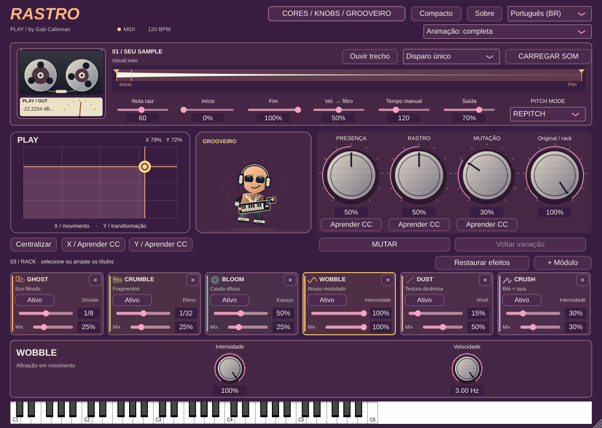

## CORES

## KNOBS

## GROOVEIRO

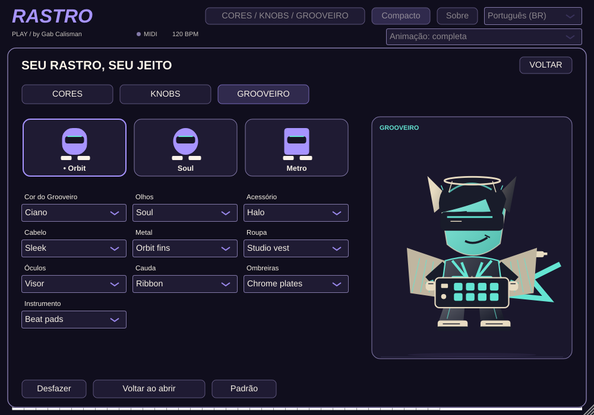

## Cosmic Arcade

## Cosmic Arcade no personalizador

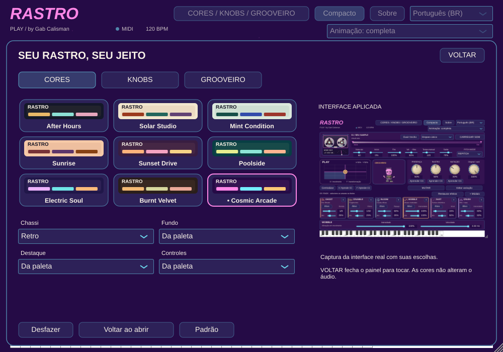

## Marfim canelado

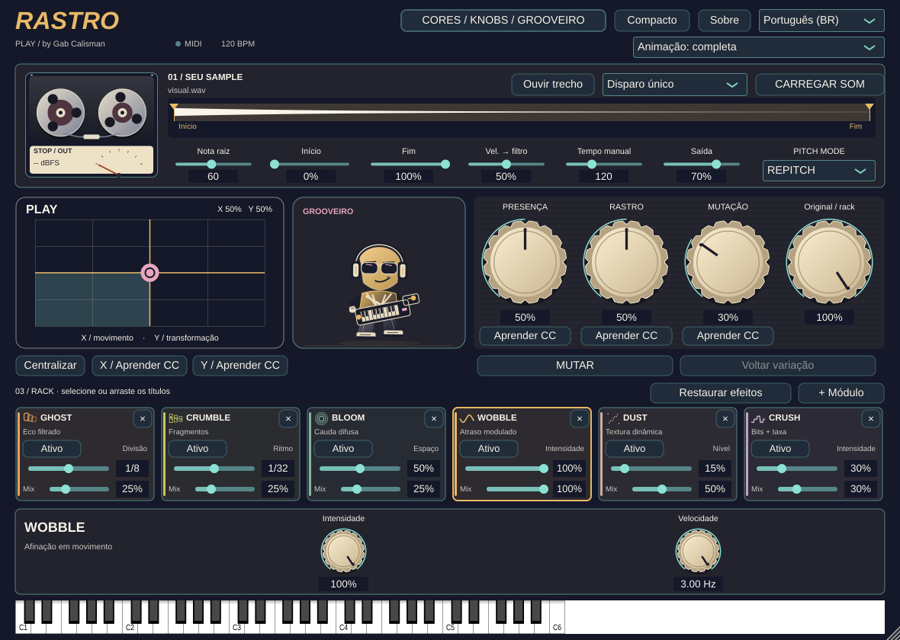

## Metal escovado

## Borracha

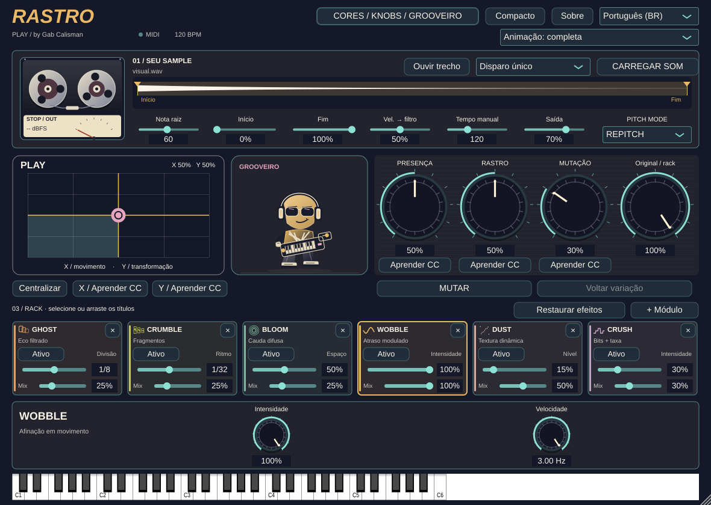

## Plástico de console

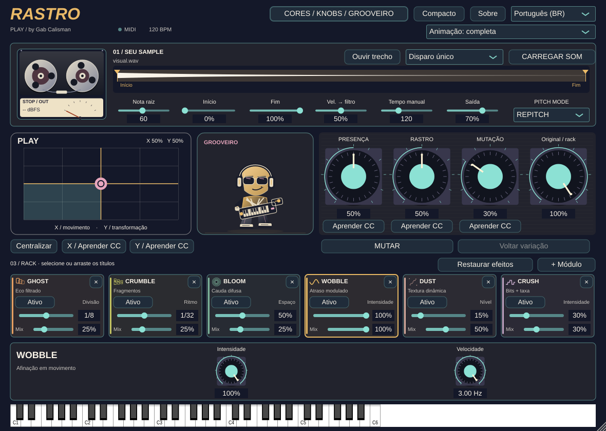

## After Hours

## Solar Studio

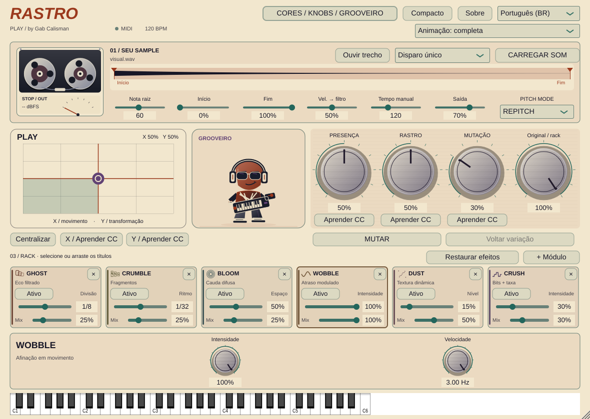

## Mint Condition

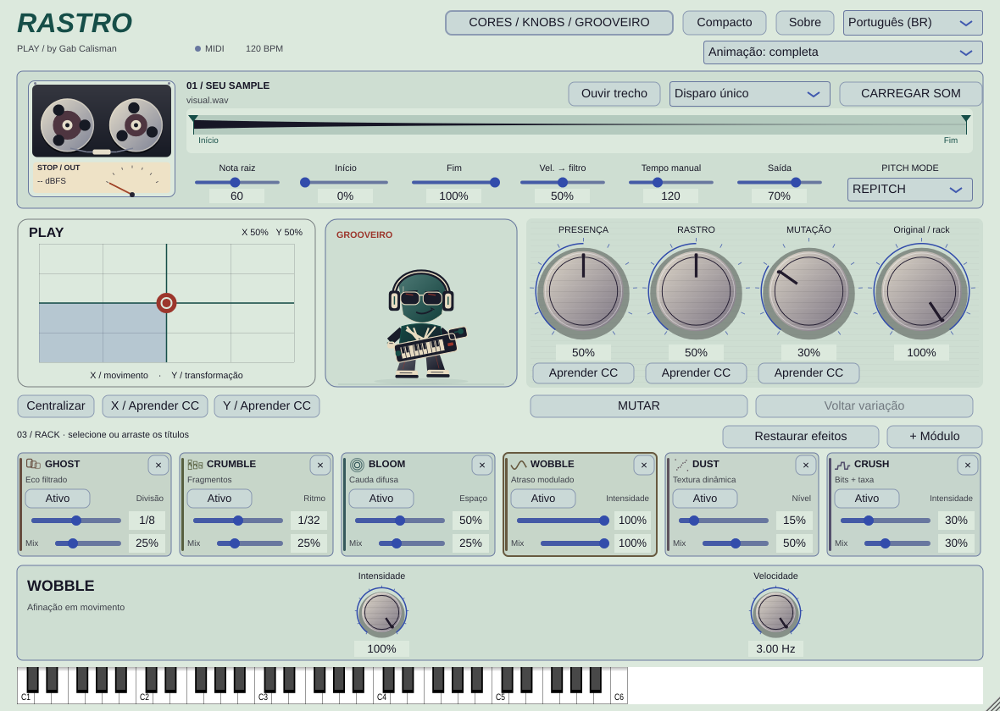

## Sunrise

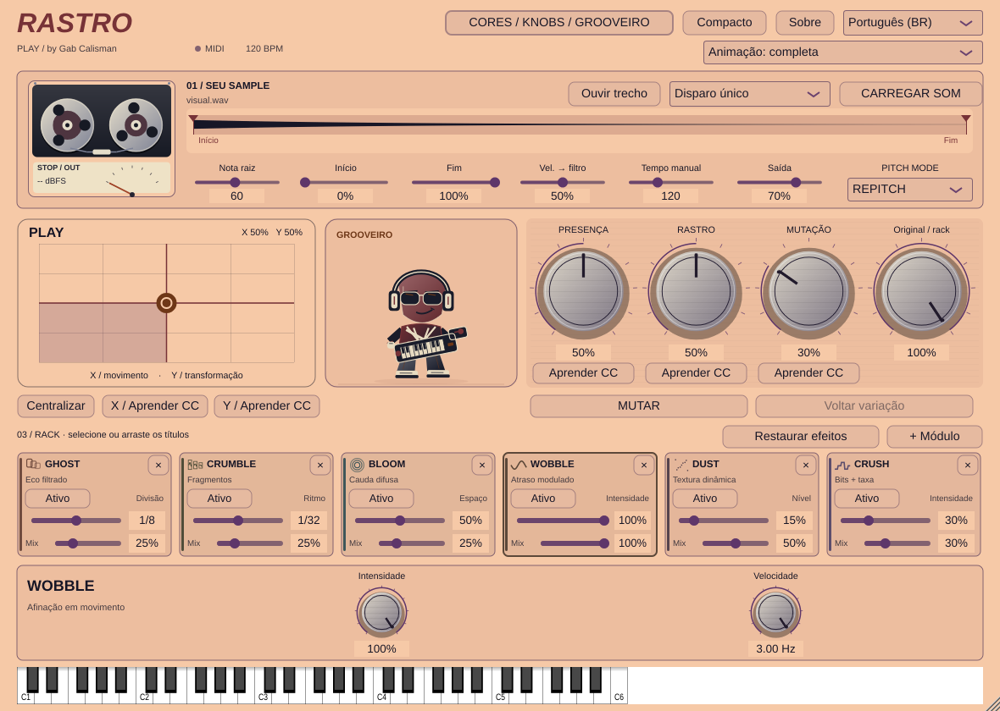

## Sunset Drive

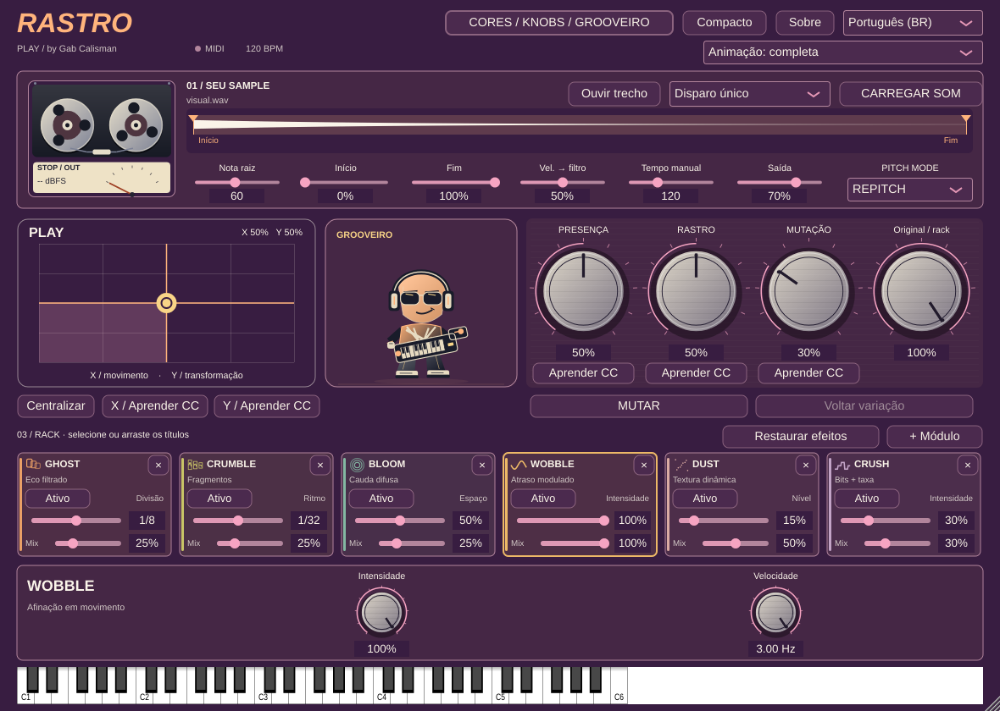

## Poolside

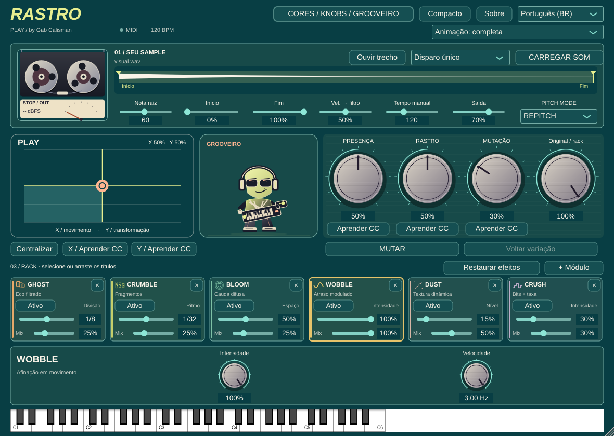

## Electric Soul

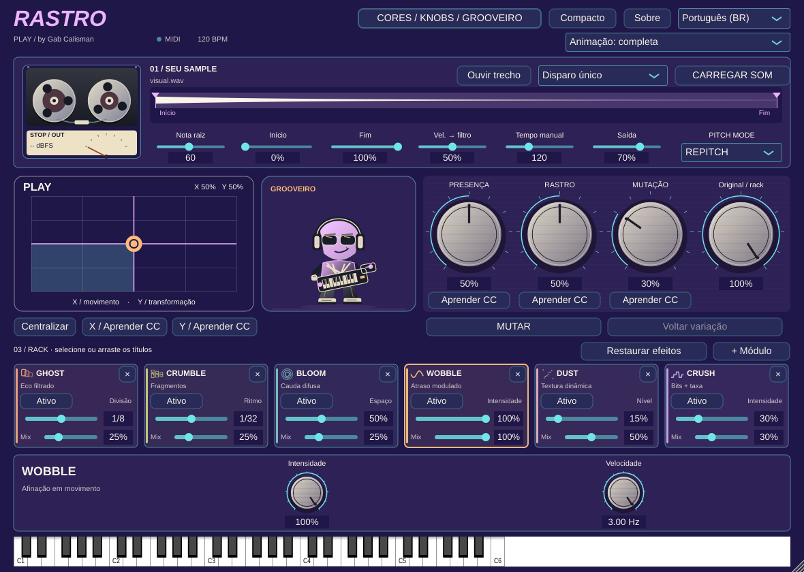

## Burnt Velvet

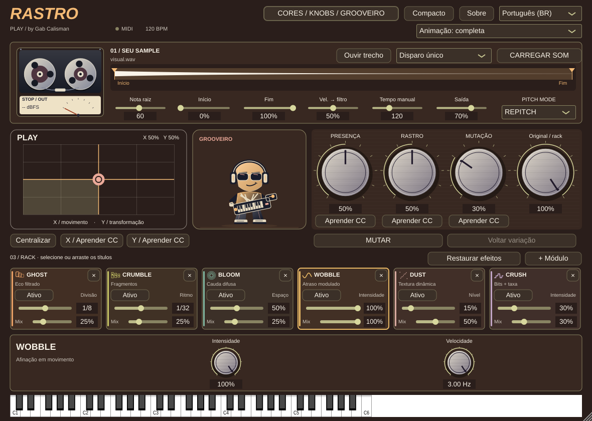
