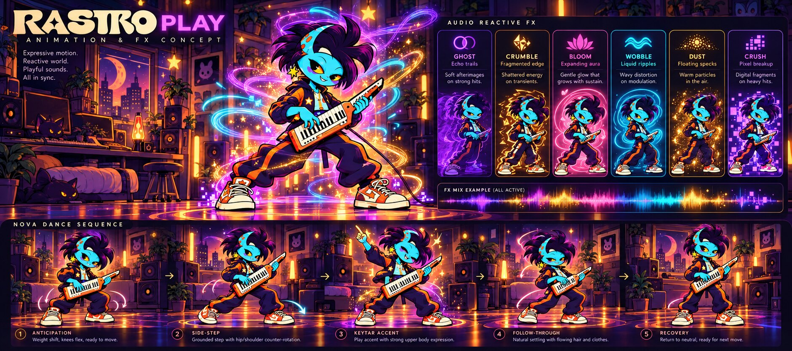

# NOVA — dança, física e luzes reativas (referência visual)

Esta nota complementa as referências oficiais do redesign. A prancha mostra a mesma NOVA em cinco poses: antecipação, passo lateral, acento tocando o keytar, continuação do movimento e recuperação. Use-a como direção visual para adaptar o personagem articulado do PR; não substitua a identidade da NOVA por outro mascote.

## Movimento e sensação física

- Dança de corpo inteiro, com centro de gravidade apoiado nos pés: flexão de joelhos, transferência de peso, passo plantado, balanço de quadril e ombros em contrarrotação.
- Use antecipação, acento, follow-through de cabelo/roupa e recuperação. Não repita um pulo ou uma oscilação no lugar como se isso fosse uma dança.
- A pose precisa continuar coerente com o keytar: duas mãos e dois braços, uma mão tocando as teclas e a outra sustentando/controlando o instrumento; nunca crie membros extras.
- A intensidade e os acentos devem vir de eventos MIDI, velocity, energia do áudio e andamento do host quando disponíveis. Em silêncio, repousar. Não animar aleatoriamente.
- Transporte global: Pause congela som e pose no ponto atual para continuar dali; Stop encerra som/animação e volta ao início da seleção conforme o comportamento acordado.
- Animação e desenho ficam na interface, fora da thread de áudio; devem respeitar movimento reduzido/desligado e pausar quando a janela não estiver visível.

## Identidade cromática dos efeitos

| Módulo | Cor e sinal visual |
| --- | --- |
| GHOST | violeta; ecos/rastros atrasados |
| CRUMBLE | âmbar; pequenas bordas/fragmentos quebrados |
| BLOOM | rosa; aura que expande e se dissipa |
| WOBBLE | ciano; ondas/ripples que deformam o contorno |
| DUST | dourado quente; partículas discretas |
| CRUSH | lavanda elétrica; blocos digitais/pixelização |

Os efeitos podem atuar juntos. A intensidade visual deve acompanhar os valores reais de quantidade/mix dos módulos ativos: mais efeito, mais brilho/alcance; pouco efeito, sinal sutil; bypass ou mix zero, sinal apagado. Misture as cores com moderação para preservar a leitura de NOVA e não cobrir rosto, roupa ou instrumento. As luzes do estúdio e reflexos no piso podem responder à mistura, sem virar um arco-íris uniforme.

## Limite desta referência

A imagem é concept art, não sprite nem prova de que física, animação, sensores de áudio ou luzes já estejam implementados. Não apresentar esses comportamentos como concluídos até verificar a integração real e testar play/pause/stop, silêncio, efeitos individuais e combinações no plugin. Esta solicitação é de apresentação visual/interface: preserve o motor de áudio, parâmetros, IDs, estado de sessão e automações do PR #4. Não altere o DSP para criar o efeito visual.
